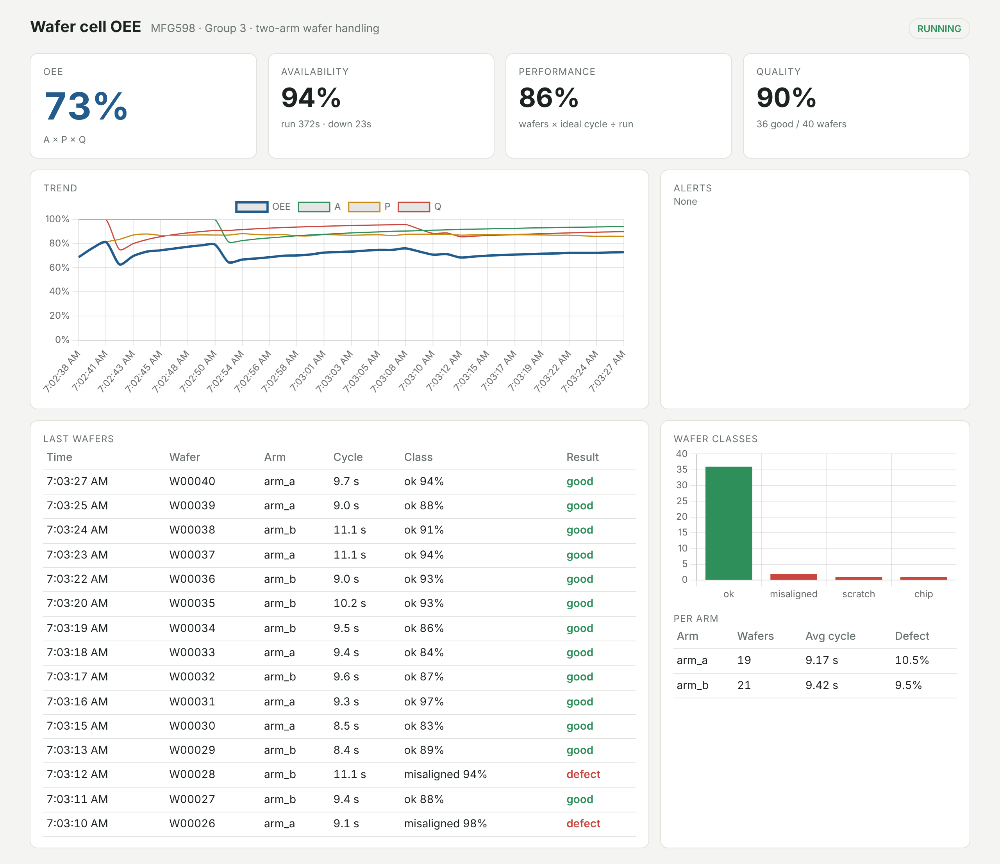

# Wafer IIoT cell (MFG598 Group 3)

Data pipeline and OEE dashboard for the two-arm handling cell in Dr. Ameri's lab: robot, PLC and camera events go through MQTT into PostgreSQL and show up on a live dashboard. The cell belongs to another student's project and is used with permission; we only read data from it.



## Status

| Part | State |
| --- | --- |
| MQTT broker, ingest, database, dashboard | Working, tested on Windows with a simulated source |
| OEE (Availability x Performance x Quality) and alerts | Working on simulated data |
| Real reader for the PLC (`edge/cell_reader.py`) | Built, read-only Modbus TCP; tested against the lab simulator (`lab/plc_sim.py`), not yet on the real cell |
| Camera capture and model training | Not built yet |

The numbers on the dashboard today come from `edge/wafer_sim.py`, a fake two-arm source. They show that the pipeline works, not how the real cell performs.

## The cell

Photos are in [`docs/setup`](docs/setup). Devices as labelled on the bench:

| Device | What it is | Address |
| --- | --- | --- |
| Allen-Bradley Micro850 PLC (2080-L50E) | Runs the conveyor through a stepper driver and reads the station sensors | 192.168.10.10 |
| Elephant Robotics Cobot Pro600 | Arm with a suction cup | 192.168.10.20 |
| Dobot M1 Pro | SCARA arm with a 3D-printed fork | 192.168.10.40 |
| Overhead camera | Black stand above the conveyor | to be confirmed |

The cell also has a conveyor with a 3D-printed carrier cradle and three 3D-printed stations (yellow, blue, grey) with small sensors wired to the PLC.

## Architecture

```
devices (arms, PLC, camera)   simulated today
        |
edge script (Python)          edge/wafer_sim.py, read_event() is the part that will change
        |  publish, QoS 1
MQTT broker (Mosquitto)       topics mfg598/group3/wafer/{wafer,oee,status}
        |  subscribe, QoS 1
ingest (cloud/ingest.py)  ->  PostgreSQL (cloud/schema.sql)
                                  |
                              dashboard (dashboard/app.py, http://localhost:5000)
```

### Wafer event

One JSON message per wafer on `.../wafer`, stored in `wafer_events`:

| Field | Meaning |
| --- | --- |
| `wafer_id` | Unique wafer number, for example W00220 |
| `arm` | `arm_a` or `arm_b` |
| `station` | Where it happened, currently `handoff` |
| `ts_start`, `ts_end` | Start and end of the transfer |
| `cycle_s` | Transfer time in seconds |
| `label`, `confidence` | Class from the camera model and its confidence (placeholder classes today) |
| `result` | `good` or `defect`, used for the quality figure |

OEE = Availability x Performance x Quality, computed in `edge/oee.py`: availability is run time over run plus down time, performance is wafers times the ideal cycle over run time, and quality is good wafers over all wafers.

## Run it on Windows

You need Python 3.10 or newer, Mosquitto and PostgreSQL. Use four PowerShell windows, each opened in the project folder.

1. **Broker users.** Create the `edge` user, then the second user in a separate file, because `mosquitto_passwd` on Windows fails when it updates an existing file:
   ```
   & "C:\Program Files\mosquitto\mosquitto_passwd.exe" -c broker\passwd edge
   & "C:\Program Files\mosquitto\mosquitto_passwd.exe" -c -b broker\passwd_cloud cloud <password>
   icacls broker\passwd_cloud /reset
   icacls broker\passwd /reset
   Get-Content broker\passwd_cloud | Add-Content broker\passwd
   Remove-Item broker\passwd_cloud
   ```
2. **Broker.** If the Mosquitto Windows service is running, stop it first with `net stop mosquitto` in an administrator PowerShell. Then start the broker from inside the `broker` folder, because `mq.conf` uses relative paths:
   ```
   cd broker
   & "C:\Program Files\mosquitto\mosquitto.exe" -c mq.conf -v
   ```
3. **Database.** Replace `19` with your PostgreSQL version:
   ```
   & "C:\Program Files\PostgreSQL\19\bin\createdb.exe" -U postgres wafer
   & "C:\Program Files\PostgreSQL\19\bin\psql.exe" -U postgres -d wafer -f cloud\schema.sql
   ```
4. **Settings.** Copy `cloud\.env.example` to `cloud\.env` and set `DATABASE_URL` and `MQTT_PASS`. If the database password contains `@`, write it as `%40` in the URL. Never commit `.env`.
5. **Packages.**
   ```
   pip install -r cloud\requirements.txt -r dashboard\requirements.txt -r edge\requirements.txt
   ```
6. **Run.** One window each:
   ```
   cd cloud;     python ingest.py
   cd dashboard; python app.py          # then open http://localhost:5000
   cd edge;      python wafer_sim.py --user edge --password <edge password> --speed 5
   ```
   Add `--burst` to the last command to force defects and trigger the `quality_low` alert.

Ingest currently logs in as the `edge` user, because the `cloud` user's login was rejected on the Windows broker. `cloud/.env.example` is set up accordingly.

## Real cell data (Modbus TCP, read-only)

The cell owner's PLC serves Modbus TCP on 192.168.10.10:502 (register map in `lab/MbSrvConf.xml`, logic in `lab/sequencer.stf`). `edge/cell_reader.py` only reads. A wafer event is published when the vision verdict counter (Pass_Count blue tape = good, Reject_Count green tape = defect) rises and the Pro 600 has lifted the wafer; run and down time come from the step and Fault registers.

Test without the cell, three windows in the project folder:
```
python lab\plc_sim.py --no-console          # the lab's PLC simulator
python lab\fake_bridges.py                  # stands in for the three robot/vision bridges
python edge\cell_reader.py --sim --dry-run  # prints events; drop --dry-run to publish to MQTT
```
Then press START on the simulated PLC (write coil 3) to run a cycle. On the real cell: `python edge\cell_reader.py --user edge --password <pw> --ideal-cycle <seconds>`.

## Repository layout

```
broker/       Mosquitto config (mq.conf)
cloud/        ingest.py, schema.sql, .env.example
dashboard/    Flask app and page
edge/         wafer_sim.py (fake source), oee.py
docs/         dashboard screenshot and setup photos
```

## Next steps

1. Run `edge/cell_reader.py` on the real cell (Monday lab) and check the numbers against what the cell does.
2. Measure the real ideal cycle time and pass it with `--ideal-cycle`.
3. Add the camera capture script, collect labelled images in several sessions, and train a small classifier (MobileNetV2 transfer learning, split by session).
4. Replace `read_event()` in `edge/wafer_sim.py` with the real reader and model.
